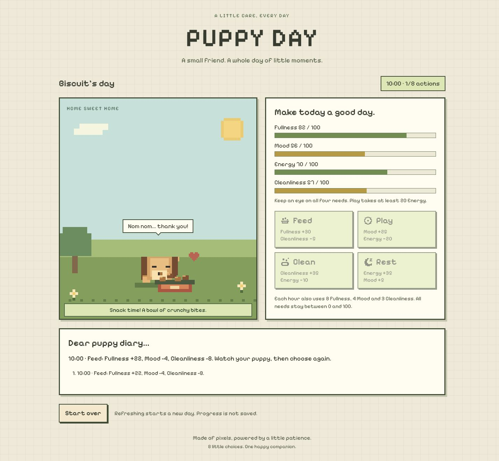

# Puppy Day

**[▶ Play Puppy Day online](https://sherryli919.github.io/puppy-day/)** — open the link, enter a puppy name, then choose **Start our day**. No download or GitHub account is needed.

A small pixel-art pet-care game. Name a puppy, read its four needs, and choose how to spend eight care actions from 09:00 to 17:00. It is for someone who wants a short, gentle game with clear choices and visible responses.

The interface is entirely in English and uses a bundled Pixelify Sans font. No account, API, runtime AI or package installation is required. The downloaded version also works offline. Progress is not saved: refreshing begins a new day.

## Run

Extract the **whole folder**, then open `index.html` in a modern browser. Keep `style.css`, `script.js`, and `assets/` alongside it. If a browser restricts local files, serve the folder:

```sh
# From the puppy-day folder, with Python 3 installed:
python -m http.server 8000 --bind 127.0.0.1
```

Open `http://127.0.0.1:8000/`. On Windows, `py -3` can replace `python`. Stop the local server with Ctrl+C. Python is only an optional static-file server; the game itself is plain HTML/CSS/JavaScript.

## Play

1. Enter a name of 1–12 characters and choose **Start our day**.
2. Choose **Feed**, **Play**, **Clean**, or **Rest**. Watch the puppy's reaction, the need bars and the diary.
3. Wait for the short reaction to finish before the next action. Repeated clicks during a reaction do not spend extra turns.
4. An unavailable action explains why and costs no time. After eight valid actions, read the summary.
5. **Start over** opens a confirmation. **Keep playing** or Escape cancels it; **Yes, start over** clears the day.

Use Tab to move between controls and Enter/Space to activate buttons. The system's reduced-motion preference keeps the activity props and text feedback while suppressing movement.

## What changed in this revision

- Pixelify Sans is included locally and used throughout the interface.
- Fixed interface text, validation messages, diary entries and summaries are in English. The name is displayed exactly as entered.
- Four drawn pixel icons identify the care controls.
- Feeding adds a bowl and food; playing adds a ball; cleaning adds bubbles; resting shows a sleeping pose and Zzz. The puppy responds visibly to each action.
- Short action locking and reset cleanup keep animation and game state in step.
- On taller phone/tablet screens, a compact sticky garden keeps the puppy visible while the player reaches the controls.

## Rules

Initial values: Fullness 60, Mood 60, Energy 70, Cleanliness 65.

| Action | Effect before the hourly cost | Unavailable when |
| --- | --- | --- |
| Feed | Fullness +30; Cleanliness −5 | Fullness >85 |
| Play | Mood +25; Energy −20 | Energy <20 |
| Clean | Cleanliness +35; Energy −10 | Cleanliness >85 or Energy <10 |
| Rest | Energy +35; Mood +5 | Energy >85 |

Each accepted action then costs 8 Fullness, 4 Mood and 3 Cleanliness, clamps all needs to 0–100 and advances one hour. Invalid actions do not change time or the diary. The ninth action is not available. These rules are unchanged from the supplied prototype.

## Source map

- `index.html`: English content, accessible controls, pixel action icons.
- `style.css`: existing garden palette, pixel font, layout and responsive styling.
- `script.js`: state, validation, actions, Canvas drawing and reaction lifecycle.
- `assets/fonts/`: the local font and its SIL Open Font License.
- `tests/interaction.test.cjs`: focused logic/lifecycle checks, using Node's built-in test runner.
- `PROCESS.md`: process notes and the still-pending real user trial.
- `CHECKS.md`: actual verification scope and limitations.
- `TESTING.md`: manual trial and regression checklist.

For the optional developer tests, install Node.js 22 or newer, then run:

```sh
node --check script.js
node --test tests/interaction.test.cjs
```

No `npm install` is needed. Automated checks do not replace a trial with another person.

## Screenshot



## Limits and submission

No sound, saved progress, backend or real-time countdown. The game uses modern Canvas, dialog and JavaScript APIs. Pixelify Sans covers the English interface; user-entered characters outside its coverage use a system fallback.

Repository: [SherryLi919/puppy-day](https://github.com/SherryLi919/puppy-day). [Play online through GitHub Pages](https://sherryli919.github.io/puppy-day/), served from the `main` branch root. A self-contained `Puppy-Day.html` is also included for convenient local use.

For Assignment 3, complete a real user trial, record your observation and resulting decision in `PROCESS.md`, credit AI assistance, and commit your own changes as they happen. Submit the public repository URL through Canvas and check it while signed out. The deadline in the supplied brief is **1 November 2026, 23:59 Hong Kong time**.
